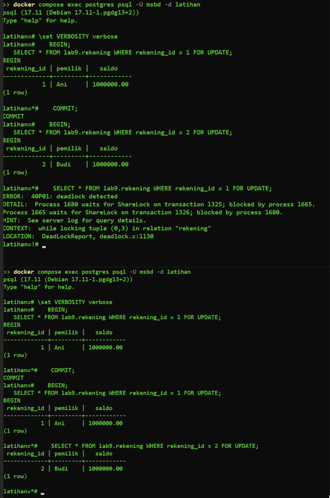
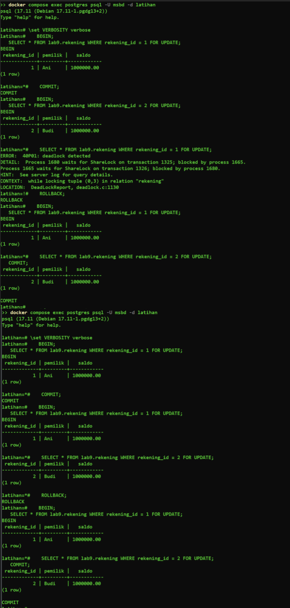
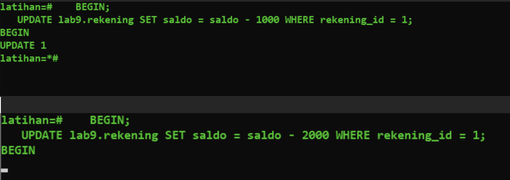
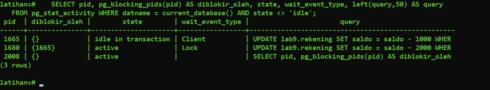
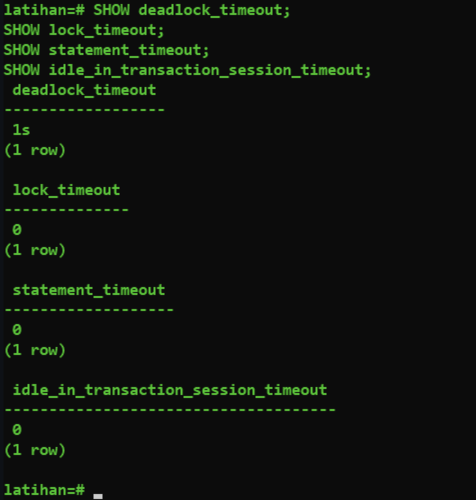
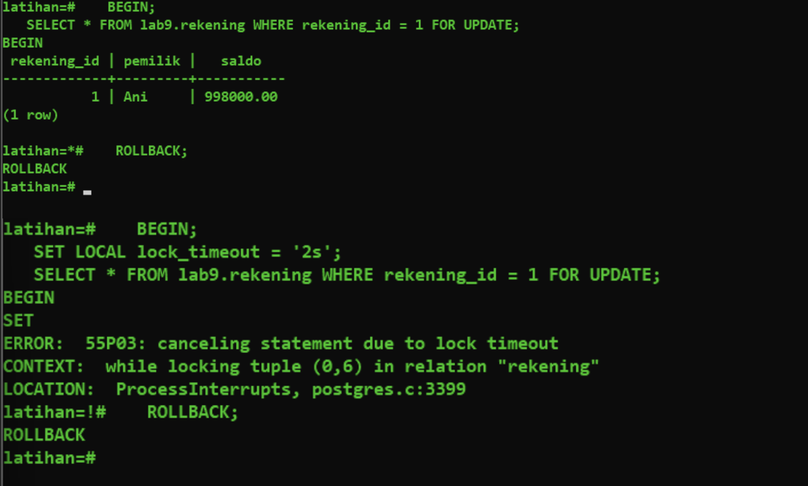

Bukti Eksekusi Langkah 4 (Q19 - Q23): Row Lock dan Deadlock

Alat: psql 17.11 lewat `docker compose exec postgres psql -U msbd -d latihan` (PostgreSQL 17), dua jendela PowerShell. Sesi A = jendela kiri, Sesi B = jendela kanan. `\set VERBOSITY verbose` aktif di kedua sesi.

Q19: FOR UPDATE pada baris yang sama
Urutan: A BEGIN + SELECT rekening 1 FOR UPDATE (Ani, 1000000.00) -> B BEGIN + SELECT rekening 1 FOR UPDATE (menunggu) -> A COMMIT -> B memperoleh hasil (Ani, 1000000.00) -> B COMMIT.

Kesimpulan: B baru mendapat kunci setelah A COMMIT.

Q20: Deadlock
Urutan: A kunci rekening 1 -> B kunci rekening 2 -> A minta rekening 2 (menunggu B) -> B minta rekening 1 (menunggu A).
Sesi yang kena error: Sesi B.
```
ERROR:  40P01: deadlock detected
DETAIL:  Process 1680 waits for ShareLock on transaction 1325; blocked by process 1665.
Process 1665 waits for ShareLock on transaction 1326; blocked by process 1680.
HINT:  See server log for query details.
CONTEXT:  while locking tuple (0,3) in relation "rekening"
LOCATION:  DeadLockReport, deadlock.c:1130
```
Setelah B dibatalkan, kunci rekening 2 terlepas dan A langsung mendapat rekening 2 (Budi, 1000000.00). Kedua sesi lalu ROLLBACK.

(Bagian atas gambar ini memuat ROLLBACK kedua sesi setelah deadlock.)

Q21: Urutan kunci konsisten (1 lalu 2)
A dan B sama-sama mengunci rekening 1 dahulu, lalu rekening 2. Tidak ada error; B hanya menunggu A COMMIT, lalu melanjutkan sampai COMMIT.
(Gambar yang sama: q20-q21-urutan-konsisten.png, bagian bawah.)
Kesimpulan: tidak terjadi deadlock.

Q22: Antrean lock panjang
A: BEGIN; UPDATE saldo = saldo - 1000 rekening 1 (UPDATE 1) tanpa COMMIT. B: BEGIN; UPDATE saldo = saldo - 2000 rekening 1 menunggu hingga A ROLLBACK, lalu UPDATE 1 muncul. Tidak ada error. Keduanya lalu ROLLBACK sehingga saldo tidak berubah.

Bukti pg_blocking_pids:
Saat A belum COMMIT/ROLLBACK, B menggantung tanpa prompt baru (tanpa error):

Hasil query dari jendela ke-3:
```
 pid  | diblokir_oleh |       state         | wait_event_type | query
 1665 | {}            | idle in transaction | Client          | UPDATE ... saldo - 1000 ...
 1680 | {1665}        | active              | Lock            | UPDATE ... saldo - 2000 ...
 2008 | {}            | active              |                 | SELECT pid, pg_blocking_pids(pid) ...
```

Pid 1680 (Sesi B) diblokir oleh pid 1665 (Sesi A) dan menunggu lock (wait_event_type = Lock), sedangkan Sesi A hanya "idle in transaction" karena transaksinya dibiarkan terbuka. Tidak ada siklus saling tunggu, jadi ini antrean lock, bukan deadlock.

Q23: Timeout
Nilai parameter (default server, tidak diubah global):
deadlock_timeout = 1s, lock_timeout = 0, statement_timeout = 0, idle_in_transaction_session_timeout = 0

Percobaan lock_timeout: A menahan kunci rekening 1; B menjalankan SET LOCAL lock_timeout = '2s' lalu SELECT ... FOR UPDATE:
```
ERROR:  55P03: canceling statement due to lock timeout
CONTEXT:  while locking tuple (0,6) in relation "rekening"
```

Kedua sesi lalu ROLLBACK.