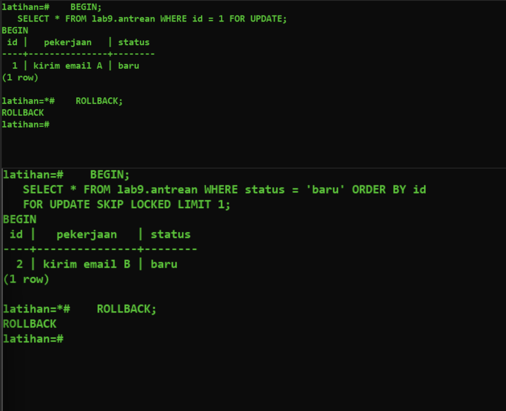
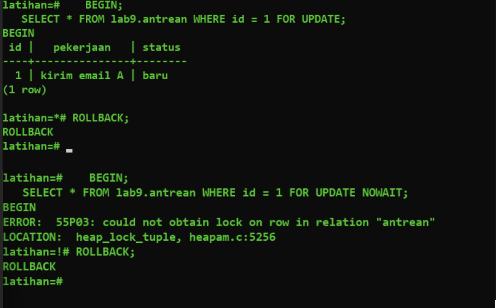
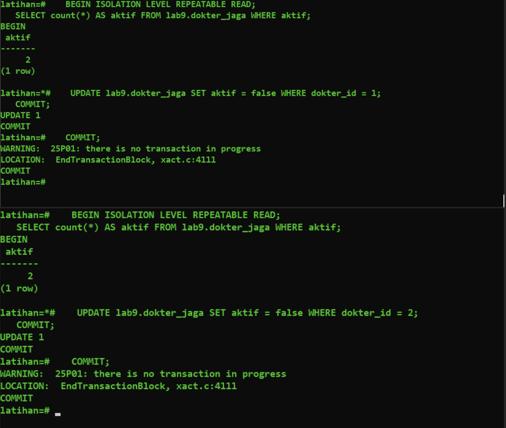
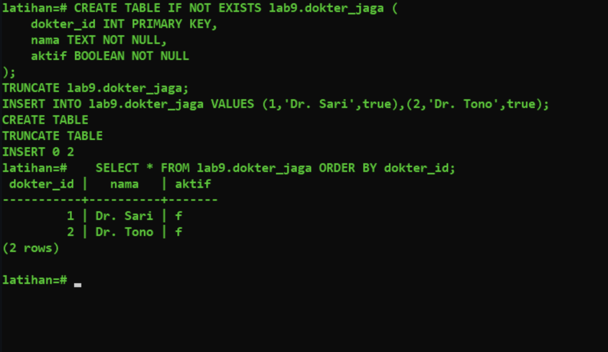
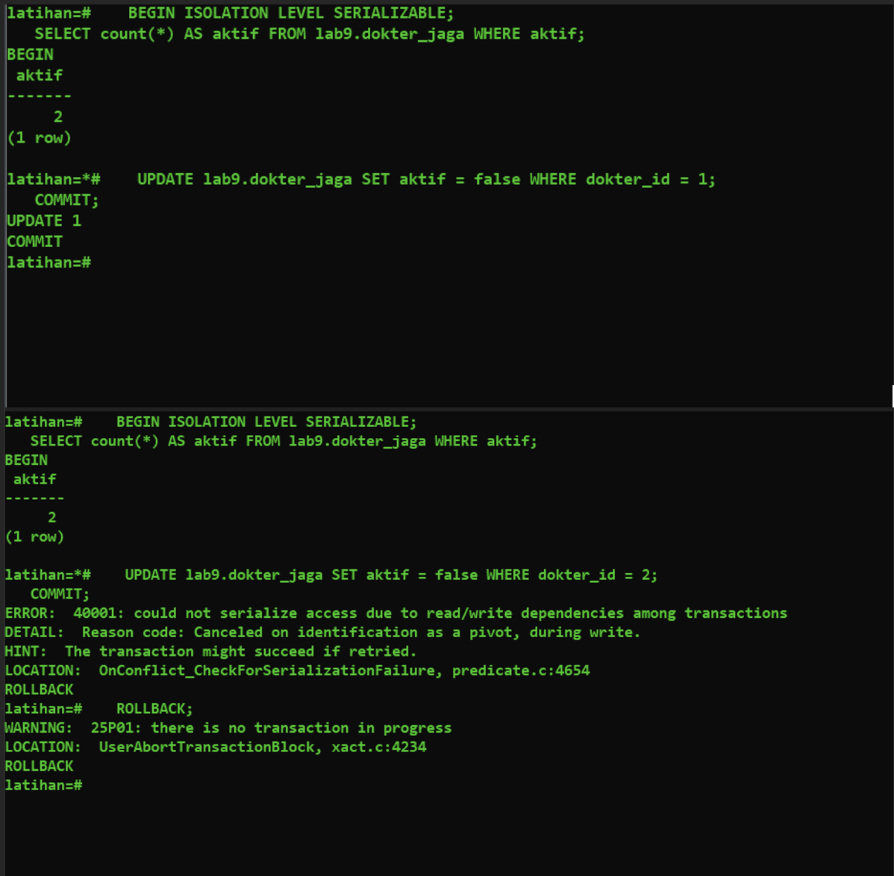
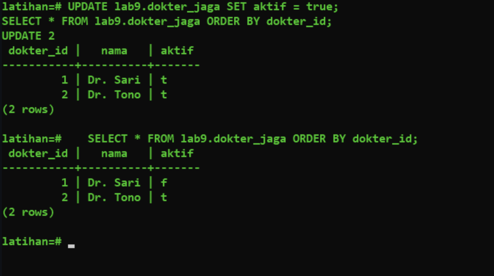
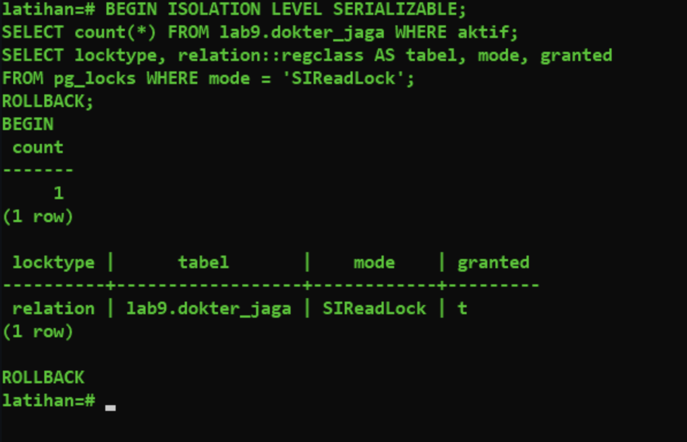
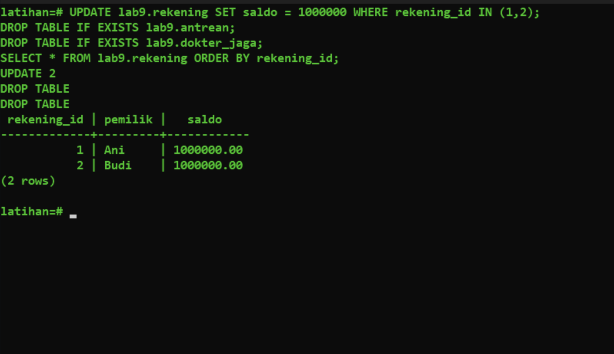

Bukti Eksekusi Langkah 5 (Q24 - Q28): SKIP LOCKED, NOWAIT, Write Skew, SERIALIZABLE

Alat: psql 17.11 (PostgreSQL 17), dua jendela PowerShell. Sesi A = kiri, Sesi B = kanan.

Q24: SKIP LOCKED
Tabel lab9.antrean berisi id 1-3 (status baru). A: BEGIN + SELECT id=1 FOR UPDATE. B: SELECT ... WHERE status='baru' ORDER BY id FOR UPDATE SKIP LOCKED LIMIT 1 langsung mengembalikan baris id = 2 (kirim email B). Baris id=1 dilewati karena terkunci A, tanpa menunggu.


Q25: NOWAIT
A mengunci id=1. B menjalankan SELECT ... WHERE id=1 FOR UPDATE NOWAIT:
```
ERROR:  55P03: could not obtain lock on row in relation "antrean"
LOCATION:  heap_lock_tuple, heapam.c:5256
```
B ROLLBACK (prompt latihan=!#), A ROLLBACK.


Q26: Write skew (REPEATABLE READ)
Tabel lab9.dokter_jaga: Dr. Sari dan Dr. Tono, keduanya aktif. Aturan: minimal satu dokter aktif.
A dan B (REPEATABLE READ) sama-sama membaca count aktif = 2. A menonaktifkan dokter 1, COMMIT (berhasil). B menonaktifkan dokter 2, COMMIT (berhasil). Tidak ada error.
(COMMIT kedua yang menghasilkan WARNING 25P01 "there is no transaction in progress" hanya karena COMMIT diketik dua kali; tidak berpengaruh.)

Isi tabel akhir: kedua dokter aktif = f.

Kesimpulan: aturan minimal satu dokter aktif dilanggar.

Q27: SERIALIZABLE
Setelah reset (kedua dokter t), skenario sama dengan SERIALIZABLE. A dan B membaca count = 2. A UPDATE dokter 1 lalu COMMIT berhasil. B UPDATE dokter 2 gagal:
```
ERROR:  40001: could not serialize access due to read/write dependencies among transactions
DETAIL:  Reason code: Canceled on identification as a pivot, during write.
HINT:  The transaction might succeed if retried.
LOCATION:  OnConflict_CheckForSerializationFailure, predicate.c:4654
```
Sesi yang gagal: Sesi B, pada pernyataan UPDATE. B lalu ROLLBACK.

Isi tabel akhir: Dr. Sari = f, Dr. Tono = t (hanya satu dokter nonaktif; aturan terjaga).


Q28: SIReadLock
Dalam transaksi SERIALIZABLE setelah SELECT count(*) ... WHERE aktif, query pg_locks menunjukkan:
```
 locktype |      tabel       |    mode    | granted
 relation | lab9.dokter_jaga | SIReadLock | t
```


Pembersihan data
Saldo rekening 1 dan 2 dikembalikan ke 1000000, tabel lab9.antrean dan lab9.dokter_jaga di-DROP.
